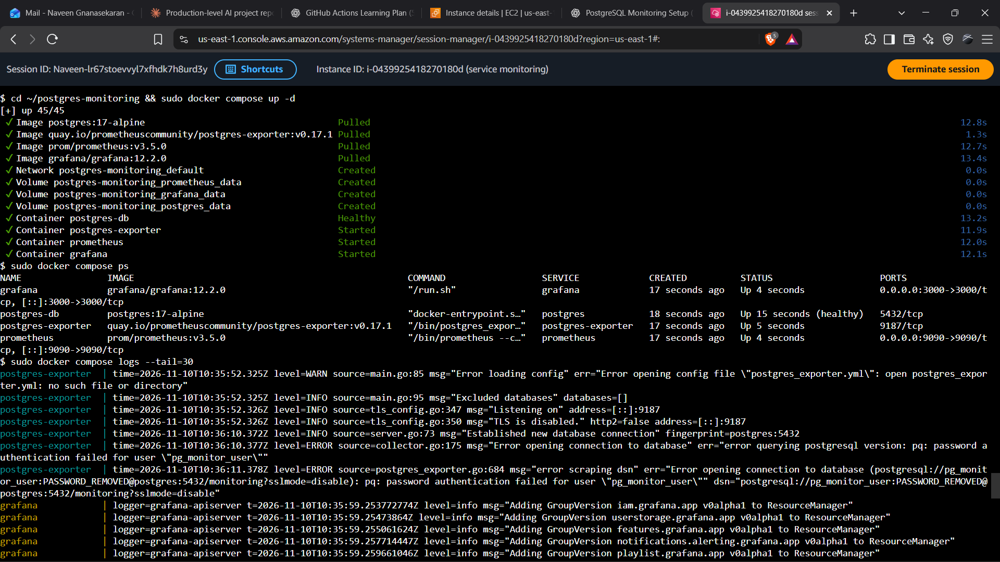
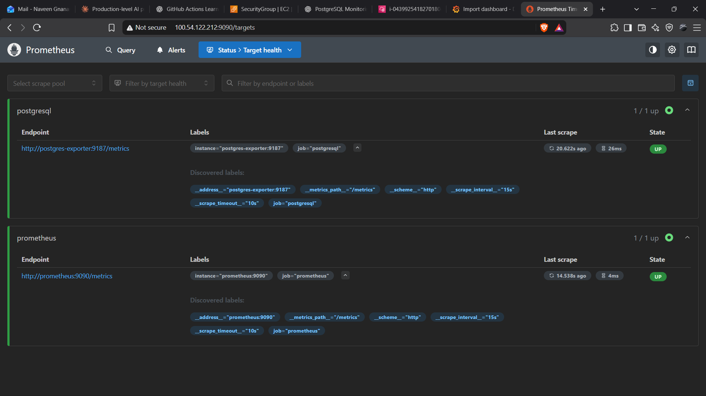
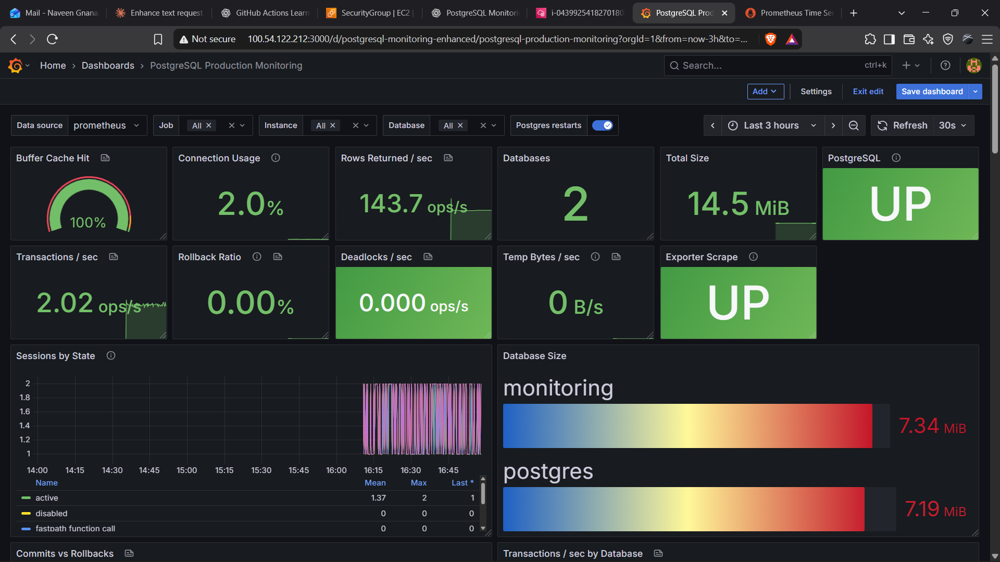
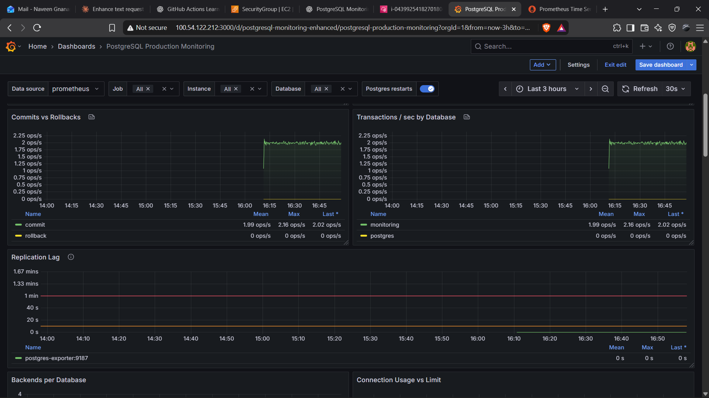
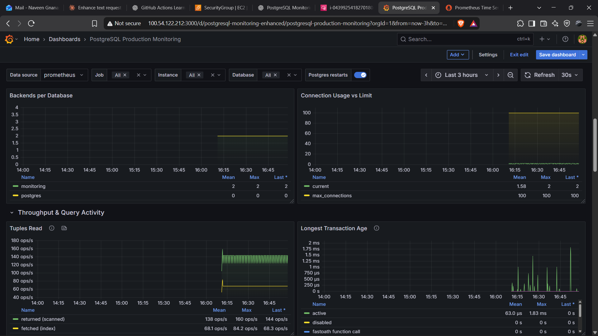

# PostgreSQL Exporter with Read-Only Monitoring User (`pg_monitor` Role)

/images/Gemini_Generated_Image_6i6te16i6te16i6t.png)

## Task Overview

Configured PostgreSQL monitoring on an AWS EC2 Ubuntu instance using Docker Compose, PostgreSQL Exporter, Prometheus, and Grafana.

The objective was to collect PostgreSQL database metrics using a dedicated read-only monitoring user, verify monitoring connectivity, and visualize database performance through a Grafana dashboard.

## Technologies Used

- AWS EC2
- Ubuntu 26.04 LTS
- Docker
- Docker Compose
- PostgreSQL
- PostgreSQL Exporter
- Prometheus
- Grafana

## Monitoring Architecture

```text
PostgreSQL
    |
    v
PostgreSQL Exporter
    |
    v
Prometheus
    |
    v
Grafana Dashboard
```

## Configuration Files

| File | Purpose |
|---|---|
| `compose.yaml` | Defines PostgreSQL and monitoring services |
| `prometheus.yml` | Configures Prometheus scrape targets |
| `postgresql-dashboard.json` | Grafana dashboard configuration |

## Monitoring Components

### PostgreSQL

- Database service.
- Manages database connections and transactions.
- Provides database statistics.

### PostgreSQL Exporter

- Collects PostgreSQL metrics.
- Uses a dedicated read-only monitoring user with the `pg_monitor` role.
- Exposes metrics for Prometheus scraping.

### Prometheus

- Scrapes and stores PostgreSQL metrics.
- Supports metric queries using PromQL.
- Monitors PostgreSQL Exporter and Prometheus targets.

### Grafana

- Uses Prometheus as its data source.
- Visualizes PostgreSQL metrics through dashboard panels.

## Deployment and Verification

Start the monitoring services:

```bash
sudo docker compose -f compose.yaml up -d
```

Check running containers:

```bash
sudo docker compose -f compose.yaml ps
```

Check service logs:

```bash
sudo docker compose -f compose.yaml logs --tail=50
```

Verify Prometheus targets:

```text
http://EC2-PUBLIC-IP:9090/targets
```

Access Grafana:

```text
http://EC2-PUBLIC-IP:3000
```

## Monitoring Metrics

- PostgreSQL availability
- Active database connections
- Transaction activity
- Cache hit ratio
- Database size
- Deadlocks
- Rows returned and fetched
- Exporter health

## Task Validation

- PostgreSQL container started successfully.
- PostgreSQL Exporter connected to the database using the monitoring user.
- Prometheus scraped exporter metrics successfully.
- Prometheus target status verified as UP.
- Grafana data source configured successfully.
- PostgreSQL monitoring dashboard imported and verified.
- Dashboard panels displayed PostgreSQL monitoring metrics.

## Evidence

The following screenshots provide visual evidence of the PostgreSQL monitoring task and its configuration.

### Screenshot 1



### Screenshot 2



### Screenshot 3



### Screenshot 4



### Screenshot 5



## Result

Successfully completed PostgreSQL monitoring configuration using Docker Compose, PostgreSQL Exporter, Prometheus, and Grafana on AWS EC2, with a dedicated read-only monitoring user assigned the `pg_monitor` role.