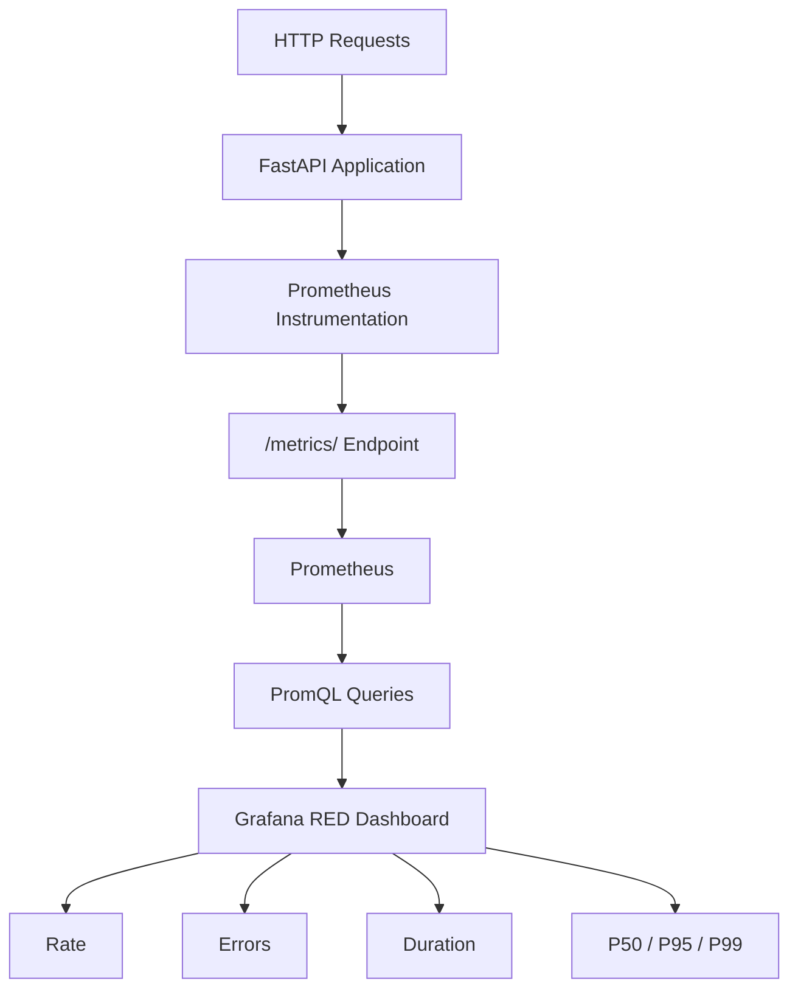

# T2.2 – RED Dashboard with P50 / P95 / P99 using `histogram_quantile()`

## Screenshots

### 1. FastAPI RED Observability Dashboard – Overview

.png)

### 2. FastAPI RED Observability Dashboard – Detailed Metrics

.png)

---

## Project Overview

In this task, I implemented a RED (Rate, Errors, Duration) monitoring setup for a FastAPI application using Prometheus and Grafana.

I instrumented the application with Prometheus metrics, configured Prometheus to scrape the application metrics, and created a single Grafana dashboard to monitor application performance and request behavior.

I also implemented latency percentile calculations (P50, P95, and P99) using Prometheus `histogram_quantile()` to understand request response times and identify latency variations.

## Objectives

- Implement Prometheus instrumentation in a FastAPI application.
- Monitor incoming HTTP request rates.
- Track HTTP error rates and status codes.
- Measure request duration using Prometheus Histogram metrics.
- Calculate P50, P95, and P99 latency using `histogram_quantile()`.
- Configure Prometheus scraping for the FastAPI application.
- Build a comprehensive single Grafana RED dashboard.
- Generate application traffic and validate the metrics.

## Technology Stack

| Component | Technology |
|---|---|
| Application | Python, FastAPI |
| Metrics Library | prometheus-client |
| Monitoring | Prometheus |
| Visualization | Grafana |
| Containerization | Docker |
| Orchestration | Docker Compose |
| Query Language | PromQL |
| Infrastructure | AWS EC2 – Ubuntu |
| Instance Access | AWS Systems Manager (SSM) |

## Architecture



The FastAPI application exposes metrics through the `/metrics/` endpoint. Prometheus periodically collects these metrics and stores them as time-series data. Grafana uses PromQL queries to visualize the collected metrics in a single dashboard.

## Implementation

### 1. FastAPI Application Instrumentation

I created a FastAPI application and integrated the Prometheus client library to expose application-level metrics.

I implemented the following metrics:

| Metric | Type | Purpose |
|---|---|---|
| `http_requests_total` | Counter | Tracks the total number of HTTP requests |
| `http_request_duration_seconds` | Histogram | Measures HTTP request processing duration |

I configured request instrumentation to record the HTTP method, endpoint, status code, and request processing duration.

### 2. Application Endpoints

I implemented different endpoints to generate application traffic and test monitoring behavior.

| Endpoint | Purpose |
|---|---|
| `/` | Main application endpoint |
| `/items` | Item-related request testing |
| `/work?delay_ms=...` | Generates requests with configurable processing delays |
| `/error` | Generates HTTP 500 responses |
| `/health` | Checks application health |
| `/metrics/` | Exposes Prometheus metrics |

I used these endpoints to generate normal traffic, delayed requests, and error responses to validate the dashboard.

### 3. Docker Compose Setup

I containerized the application and monitoring components using Docker Compose.

The environment includes:

- FastAPI application container.
- Prometheus monitoring container.
- Grafana visualization container.

I configured the service connections, container ports, and monitoring configurations to allow Prometheus to scrape the FastAPI metrics and Grafana to query Prometheus.

### 4. Prometheus Configuration

I configured Prometheus to scrape metrics from the FastAPI application.

**Scrape configuration:**

```yaml
scrape_configs:
  - job_name: "fastapi"
    static_configs:
      - targets: ["fastapi:8000"]
```

I verified that the FastAPI target was available and reporting an UP status in Prometheus.

### 5. Grafana Dashboard Development

I created a single Grafana dashboard named:

**FastAPI | RED Observability Dashboard**

I configured the Prometheus data source and added panels to monitor request traffic, application errors, response latency, and endpoint-level request information.

The dashboard includes the following 12 panels:

| No. | Dashboard Panel | Purpose |
|---|---|---|
| 1 | Request Rate | Displays the number of requests per second |
| 2 | 5XX Error Rate | Displays the percentage of server errors |
| 3 | P95 Response Latency | Displays the 95th percentile response time |
| 4 | Total Requests | Displays the total number of requests |
| 5 | Application Availability | Displays whether the FastAPI target is UP or DOWN |
| 6 | Instantaneous Request Rate | Displays the current request rate |
| 7 | Request Traffic by HTTP Method | Compares request traffic by HTTP method |
| 8 | Latency Percentiles – P50 / P95 / P99 | Compares the three latency percentiles |
| 9 | Server Error Trend – HTTP 5XX | Tracks server errors over time |
| 10 | Request Rate by Endpoint | Compares request rates across endpoints |
| 11 | HTTP Status Code Distribution | Displays the distribution of HTTP response codes |
| 12 | Endpoint Request Summary | Displays endpoint-level request information |

## RED Metrics Implementation

### 1. Rate

I used Prometheus `rate()` to calculate the per-second HTTP request rate over a time window.

```promql
sum(rate(http_requests_total[5m]))
```

This helps monitor incoming application traffic and identify changes in request volume.

### 2. Errors

I used the HTTP status code label to monitor server-side errors.

```promql
sum(rate(http_requests_total{status=~"5.."}[5m]))
```

I also calculated the percentage of failed requests:

```promql
100 *
sum(rate(http_requests_total{status=~"5.."}[5m]))
/
sum(rate(http_requests_total[5m]))
```

This helps identify increases in HTTP 5XX errors.

### 3. Duration

I used the Histogram metric `http_request_duration_seconds` to collect request processing duration.

The histogram generates bucket-based observations that can be used to calculate latency percentiles.

### 4. P50, P95 and P99 using `histogram_quantile()`

This was the main focus of the task.

I used `histogram_quantile()` with the Prometheus histogram bucket metric to calculate latency percentiles.

**P50 – Median Latency**

```promql
histogram_quantile(
  0.50,
  sum by (le) (
    rate(http_request_duration_seconds_bucket[5m])
  )
)
```

**P95 – 95th Percentile Latency**

```promql
histogram_quantile(
  0.95,
  sum by (le) (
    rate(http_request_duration_seconds_bucket[5m])
  )
)
```

**P99 – 99th Percentile Latency**

```promql
histogram_quantile(
  0.99,
  sum by (le) (
    rate(http_request_duration_seconds_bucket[5m])
  )
)
```

I used `sum by (le)` to aggregate histogram buckets while preserving the `le` label required by `histogram_quantile()`.

These percentiles help understand the distribution of request latency:

- **P50:** 50% of requests completed within this duration.
- **P95:** 95% of requests completed within this duration.
- **P99:** 99% of requests completed within this duration.

I visualized all three percentiles together in a single Grafana panel to compare normal response times with higher-latency requests.

## Testing and Validation

After completing the configuration, I generated different types of HTTP requests to validate the monitoring setup.

I performed the following checks:

1. Verified that the FastAPI application was running.
2. Checked the `/metrics/` endpoint to confirm that Prometheus metrics were exposed.
3. Verified the FastAPI scrape target in Prometheus.
4. Generated normal HTTP requests to test request-rate metrics.
5. Generated delayed requests using the `/work` endpoint to observe latency changes.
6. Generated HTTP 500 responses using the `/error` endpoint to test error monitoring.
7. Verified P50, P95, and P99 calculations in Grafana.
8. Checked the HTTP status code distribution and endpoint request summary.
9. Verified that all dashboard panels were available in one Grafana dashboard.

## Observed Results

During validation, I observed the following dashboard values in the captured monitoring session:

| Metric | Observed Value |
|---|---:|
| Total Requests | 162 |
| Request Rate | 0.42 req/s |
| 5XX Error Percentage | 8.40% |
| P95 Response Latency | 225.250 ms |
| Application Availability | UP |
| HTTP 200 Responses | 152 |
| HTTP 500 Responses | 10 |

These values represent the captured test session and can change as new requests are generated.
```

## Key Learnings

Through this task, I gained practical experience in:

- Instrumenting FastAPI applications with Prometheus metrics.
- Understanding Counter and Histogram metric types.
- Configuring Prometheus scrape targets.
- Writing PromQL queries using `rate()` and `sum()`.
- Understanding histogram buckets and the `le` label.
- Calculating P50, P95, and P99 using `histogram_quantile()`.
- Monitoring application traffic, errors, and response duration.
- Building a comprehensive Grafana dashboard.
- Containerizing monitoring components using Docker Compose.
- Validating application observability through generated traffic.

## Outcome

Successfully implemented and validated a complete FastAPI RED observability setup using Prometheus and Grafana.

Created a single 12-panel Grafana dashboard covering request rate, error rate, application availability, endpoint-level traffic, HTTP status distribution, and P50/P95/P99 latency percentiles using `histogram_quantile()`.

All application configurations, Prometheus configurations, Grafana dashboard JSON, documentation, and validation screenshots are maintained in this task folder.